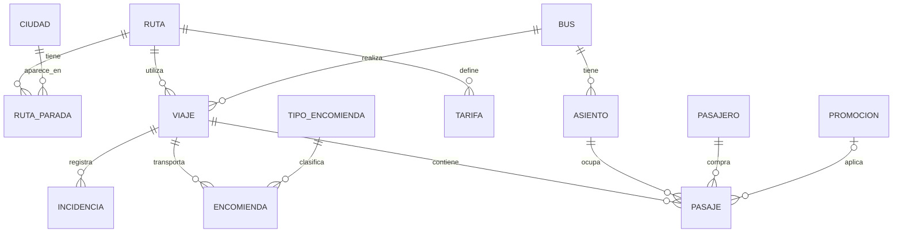

# Guía para el diagrama ER de TransAndina

Este documento sirve como base para diseñar el diagrama entidad-relación en notación crow's foot y para trasladar el modelo posterior a un script SQL de PostgreSQL.

## 1. Entidades principales por épica

### Épica 1 - Configuración del servicio

#### RUTA

- `id_ruta`: clave primaria.
- `codigo`: texto único.
- Representa un recorrido entre varias paradas.

#### CIUDAD

- `nombre`: clave primaria.
- Una misma ciudad puede aparecer en varias rutas.
- Se recomienda almacenar las ciudades una sola vez.

#### RUTA_PARADA

- `ruta_id`: clave foránea.
- `ciudad_nombre`: clave foránea.
- `posicion`: entero que define el orden.

Restricciones:

- `UNIQUE (ruta_id, ciudad_nombre)`: la ciudad no se repite en una misma ruta.
- `UNIQUE (ruta_id, posicion)`: no existen dos paradas en la misma posición.
- La ruta debe tener al menos dos paradas.

Esta tabla es necesaria porque el orden es parte del negocio y no debe quedar registrado solo por el arreglo del sistema.

#### BUS

- `id_bus`: clave primaria.
- `placa`: texto único.
- `capacidad`: entero entre 1 y 80.
- `amenidades`: JSONB.

#### ASIENTO

- `bus_id`: clave foránea.
- `numero`: entero entre 1 y la capacidad del bus.

Restricciones:

- `UNIQUE (bus_id, numero)`.
- Deben existir los asientos 1 hasta la capacidad.

Puede crearse por medio de una función o de una inserción controlada en `fn_crear_bus`.

#### VIAJE

- `id_viaje`: clave primaria.
- `ruta_id`: clave foránea.
- `bus_id`: clave foránea.
- `salida`: `timestamptz`.
- `llegada`: `timestamptz`.

Restricciones:

- `llegada > salida`.
- Un bus no puede tener viajes con horarios cruzados.

#### TARIFA

- `id_tarifa`: clave primaria.
- `ruta_id`: clave foránea.
- `origen_pos`: posición de origen.
- `destino_pos`: posición de destino.
- `precio`: `numeric`.
- `creada_en`: fecha y hora de fijación.

Esta tabla debe ser append-only. Cada modificación agrega una nueva fila y no elimina ni sobrescribe las tarifas anteriores.

Restricciones:

- `origen_pos < destino_pos`.
- `precio > 0`.
- La tarifa vigente es la última registrada para el par origen-destino.

### Épica 2 - Venta

#### PASAJERO

- `ci`: clave primaria.
- `nombre`: texto.

Si el CI ya existe, se debe actualizar el nombre al vender o reservar.

#### PASAJE

- `id_pasaje`: clave primaria.
- `viaje_id`: clave foránea.
- `asiento_id`: clave foránea.
- `pasajero_ci`: clave foránea.
- `origen_pos`: posición inicial del tramo.
- `destino_pos`: posición final del tramo.
- `precio_base`: precio sin promoción.
- `precio_vendido`: precio cobrado o reservado.
- `estado`: `pagado`, `reservado` o `anulado`.
- `vence_en`: fecha y hora de vencimiento para reservas.
- `promocion_id`: clave foránea opcional.

Se recomienda usar una sola tabla para ventas y reservas.

- Las ventas tienen estado `pagado`.
- Las reservas tienen estado `reservado` mientras están vigentes.
- Las reservas vencidas dejan de ocupar asiento.
- Las reservas pagadas cambian a `pagado`.
- Las anulaciones cambian el estado a `anulado`, pero no eliminan la fila.

Para cada pasaje se conserva el precio con el que se vendió o reservó.

#### PROMOCION

- `id_promocion`: clave primaria.
- `nombre`: texto.
- `porcentaje`: `numeric`.
- `condiciones`: JSONB.
- `creada_en`: fecha y hora de creación.

Condiciones admitidas:

- `ruta`: código de la ruta.
- `desde`: fecha inicial.
- `hasta`: fecha final.
- `dias_semana`: arreglo de enteros de 1 a 7.
- `antelacion_min_dias`: entero mayor o igual que cero.

Es necesario rechazar cualquier otra clave dentro de JSONB.

### Épica 3 - Reportes y control

#### INCIDENCIA

- `id_incidencia`: clave primaria.
- `viaje_id`: clave foránea.
- `tipo`: texto.
- `datos`: JSONB.
- `creada_en`: fecha y hora.

Los datos varían según el tipo:

- `retraso`: `minutos` y `motivo`.
- `averia`: `descripcion` y `requiere_cambio_bus`.
- `control`: `lugar` y `resultado`.

La validación debe realizarse en PostgreSQL.

#### AUDITORIA

- `id_auditoria`: clave primaria.
- `tabla`: texto.
- `operacion`: texto.
- `fecha`: `timestamptz`.
- `datos_anteriores`: JSONB.
- `datos_nuevos`: JSONB.

Debe alimentarse con triggers de los cambios en pasajes y tarifas.

Las entidades utilizadas para los reportes también incluyen `VIAJE`, `PASAJE`, `TARIFA` y `PROMOCION`, descritas en las épicas anteriores.

### Épica 4 - Operación confiable

Esta épica no introduce una entidad nueva. Sus reglas se implementan con restricciones y mecanismos sobre las entidades existentes:

- `PASAJE`: exclusión concurrente de asientos en tramos solapados.
- `VIAJE`: exclusión de viajes cruzados del mismo bus.
- `PASAJE`, `VIAJE`, `ENCOMIENDA` e `INCIDENCIA`: índices para cumplir los tiempos de consulta.
- `PASAJE`: validación de estados y reservas vigentes.

El diagrama puede representar esta épica como una nota de restricciones o como una leyenda, sin agregar tablas que dupliquen información.

### Épica 5 - Encomiendas

#### TIPO_ENCOMIENDA

- `tipo`: texto.
- `version`: entero.
- `campos`: JSONB.
- `vigencia_desde`: fecha y hora.

Clave primaria compuesta:

- `(tipo, version)`

La tabla permite redefinir un tipo sin modificar los registros anteriores.

Clases admitidas:

- `texto`
- `numero`
- `numero_positivo`
- `si_no`

#### ENCOMIENDA

- `id_encomienda`: clave primaria.
- `viaje_id`: clave foránea.
- `origen_pos`: posición inicial.
- `destino_pos`: posición final.
- `tipo`: texto.
- `tipo_version`: entero.
- `atributos`: JSONB.
- `creada_en`: fecha y hora.

Esta tabla debe relacionarse con el tipo y la versión usados al registrar la encomienda.

Ejemplo de atributos:

```json
{
  "destinatario": {
    "nombre": "Ana Pérez",
    "telefono": "70012345"
  },
  "peso_kg": 12,
  "fragil": true
}
```

## 2. Relaciones entre entidades



### Cardinalidades

- Una ruta tiene como mínimo dos paradas.
- Una parada pertenece exactamente a una ruta y una ciudad.
- Una ciudad puede aparecer en muchas rutas.
- Un bus tiene entre 1 y 80 asientos.
- Un asiento pertenece exactamente a un bus.
- Un viaje pertenece a una ruta y usa exactamente un bus.
- Un pasaje pertenece exactamente a un viaje.
- Un pasaje ocupa exactamente un asiento.
- Un pasajero puede tener muchos pasajes.
- Una tarifa pertenece a una ruta.
- Una promoción puede aplicarse a cero o muchos pasajes.
- Una incidencia pertenece exactamente a un viaje.
- Una encomienda pertenece exactamente a un viaje.
- Una encomienda usa exactamente una versión de tipo.

## 3. Representación de los tramos

Cada pasaje guarda el origen y el destino como posiciones de la ruta:

```text
origen_pos = 1
destino_pos = 3
```

En PostgreSQL, puede representarse el tramo interno con un rango:

```sql
int4range(origen_pos, destino_pos, '[)')
```

Ejemplo:

- Cbba a Caracollo: `[1, 2)`.
- Cbba a La Paz: `[1, 4)`.
- Caracollo a La Paz: `[2, 4)`.
- Dos tramos se solapan si sus rangos tienen una intersección.

### Interpretación de segmentos

La posición representa una parada y el rango representa los segmentos recorridos:

- Bajar en Caracollo y subir en Caracollo no produce solapamiento.
- La ruta Cbba–Caracollo–Patacamaya–La Paz tiene:
  - Cbba–Caracollo: segmento 1.
  - Caracollo–Patacamaya: segmento 2.
  - Patacamaya–La Paz: segmento 3.

## 4. Concurrencia

Para evitar ventas simultáneas de asientos solapados se recomienda una restricción EXCLUDE.

Campos sugeridos:

- `viaje_id`
- `asiento_id`
- rango de segmentos

Ejemplo conceptual:

```sql
EXCLUDE USING gist (
    viaje_id WITH =,
    asiento_id WITH =,
    segmentos WITH &&
)
WHERE (estado <> 'anulado')
```

La condición debe considerar que una reserva vencida ya no ocupa el asiento.

En este diagrama, las reservas vencidas no deben mostrar estado `reservado`; pueden permanecer como registros históricos y una consulta debe validarlas mediante `vence_en`.

## 5. Uso de JSONB

### Amenidades del bus

Ejemplo:

```json
{
  "wifi": true,
  "baño": true,
  "televisor": {
    "pantalla_por_asiento": true
  }
}
```

Se guarda como JSONB porque una misma empresa puede incorporar comodidades nuevas sin modificar el esquema.

Índice GIN recomendado:

```sql
CREATE INDEX ix_bus_amenidades
ON bus
USING gin (amenidades jsonb_path_ops);
```

El filtrado debe usar el operador `@>`.

### Condiciones de promoción

Las condiciones se guardan como JSONB porque el número y combinación de filtros pueden cambiar.

Ejemplo:

```json
{
  "ruta": "CBBA-LPZ",
  "desde": "2026-12-01",
  "hasta": "2026-12-31",
  "dias_semana": [6, 7],
  "antelacion_min_dias": 7
}
```

Debe existir:

- Validación de claves desconocidas.
- Validación de ruta existente.
- Validación de rango de fechas.
- Validación del porcentaje.
- Validación de los días de semana.
- Aplicación de la zona horaria `America/La_Paz`.

### Datos de incidencia

JSONB es adecuado porque cada tipo de incidencia posee campos diferentes.

La base debe validar en `fn_registrar_incidencia`:

- Tipo conocido.
- Campos obligatorios.
- Tipos correctos de JSONB.
- Resultado permitido para los controles.

### Definición y atributos de encomienda

Se recomienda separar:

- La definición del tipo y sus campos obligatorios.
- Los atributos particulares de cada encomienda.

La definición se guarda de forma versionada y los atributos como JSONB.

Índice GIN recomendado:

```sql
CREATE INDEX ix_encomienda_atributos
ON encomienda
USING gin (atributos jsonb_path_ops);
```

La búsqueda debe usar `@>` para que coincidan todos los datos solicitados.

## 6. Índices recomendados

Índices mínimos sugeridos:

```sql
CREATE INDEX ix_asiento_bus_numero
ON asiento (bus_id, numero);

CREATE INDEX ix_viaje_bus_salida
ON viaje (bus_id, salida);

CREATE INDEX ix_tarifa_vigente
ON tarifa (ruta_id, origen_pos, destino_pos, creada_en DESC);

CREATE INDEX ix_pasaje_viaje_asiento_estado
ON pasaje (viaje_id, asiento_id, estado);

CREATE INDEX ix_pasaje_viaje_pasajero
ON pasaje (viaje_id, pasajero_ci);

CREATE INDEX ix_ruta_parada_ruta_posicion
ON ruta_parada (ruta_id, posicion);

CREATE INDEX ix_incidencia_viaje
ON incidencia (viaje_id);

CREATE INDEX ix_encomienda_viaje
ON encomienda (viaje_id);
```

Los índices GIN de JSONB deben medirse con EXPLAIN ANALYZE y justificarse en el informe de rendimiento.

## 7. Tabla de trazabilidad

| Historia | Entidades o atributos | Restricciones y comportamientos |
|---|---|---|
| HU-01 | RUTA, CIUDAD, RUTA_PARADA | Código único, mínimo dos paradas, posición única, ciudad no repetida por ruta |
| HU-02 | BUS, ASIENTO | Placa única, capacidad entre 1 y 80, asientos consecutivos |
| HU-03 | VIAJE | Llegada posterior a salida, no cruce de horarios por bus |
| HU-04 | TARIFA | Origen antes que destino, precio positivo, histórico, vigente es la última |
| HU-05 | PASAJE, ASIENTO, VIAJE | Existencia de asiento, tramo válido, solapamiento bloqueado |
| HU-06 | PASAJE, ASIENTO | Disponibilidad por tramo, reserva vencida no ocupa |
| HU-07 | PASAJERO, PASAJE | CI único, nombre actualizado, no solapamiento por pasajero |
| HU-08 | PASAJE | Vigencia positiva, bloquea mientras está vigente |
| HU-09 | PASAJE | Solo reserva vigente, pago único, precio congelado |
| HU-10 | PASAJE | Anulación antes de salida, estado anulado, nunca borrar |
| HU-11 | PASAJE, VIAJE, RUTA_PARADA | Una fila por segmento, cuenta pagados y reservas vigentes |
| HU-12 | PASAJE | Suma solo pasajes pagados al precio vendido |
| HU-13 | AUDITORIA | Triggers INSERT, UPDATE y DELETE en pasajes y tarifas |
| HU-16 | PROMOCION, PASAJE | Porcentaje válido, condiciones válidas, mayor descuento, más antigua si empatan |
| HU-17 | INCIDENCIA | Tipo conocido y datos JSONB válidos |
| HU-18 | PROMOCION, PASAJE | Diferencia base menos cobrado solo en pasajes pagados |
| HU-19 | TIPO_ENCOMIENDA | Tipos iniciales, clases conocidas y versionado |
| HU-20 | ENCOMIENDA, TIPO_ENCOMIENDA | Destinatario obligatorio, datos exigidos, tipo correcto y tramo válido |
| HU-21 | ENCOMIENDA | Contención JSONB, datos anidados, orden por ID |

## 8. Justificación de columnas, tablas y JSONB

### Usar columnas y tablas

Son apropiadas para:

- Relaciones y llaves.
- Fechas de salida y llegada.
- Estados del pasaje.
- Precios.
- Posiciones de origen y destino.
- Datos que necesitan restricciones, índices o joins frecuentes.

### Usar JSONB

Es apropiado para:

- Amenidades variables de los buses.
- Condiciones opcionales de promociones.
- Datos variables de incidencias.
- Campos adicionales de encomiendas.
- Auditoría completa de una fila.

Las funciones deben validar JSONB antes de insertar o actualizar datos.

## 9. Propósito del diagrama

El diagrama debe permitir responder cómo se mapea cada historia de usuario a tablas y restricciones.

Debe incluir:

- Todas las entidades.
- Llaves primarias y foráneas.
- Cardinalidades en notación crow's foot.
- Restricciones más importantes.
- Campos JSONB.
- Tabla de trazabilidad.
- Justificación de columnas, tablas y JSONB.

## 10. Herramientas recomendadas

- draw.io / diagrams.net.
- dbdiagram.io.
- Lucidchart.
- Microsoft Visio.

Después se puede exportar a PDF. Conviene usar una notación consistente y evitar abreviaturas difíciles de entender.
