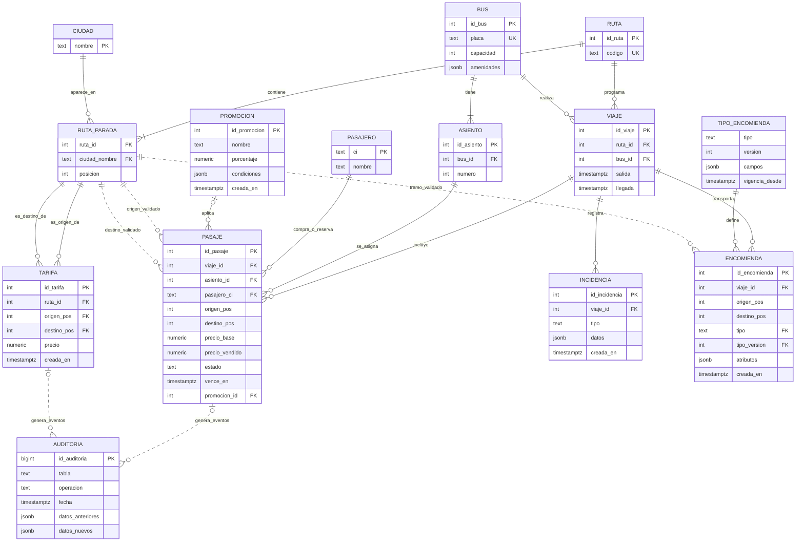

# TransAndina — Diagrama ER y trazabilidad

**Proyecto:** TransAndina  
**Curso:** Bases de Datos II  
**Integrante:** Sarzuri Mamani Joas Jason  
**Modelo de referencia:** `transAndinaDBML.dbml` — épicas 1 a 5

Este documento contiene el diagrama entidad-relación en notación crow's foot, la trazabilidad entre historias, tablas y restricciones, y la justificación de las decisiones de modelado.

## Diagrama entidad-relación

### Cómo leer el diagrama

- `||` significa exactamente uno; `o|`, cero o uno; `|{`, uno o más; `o{`, cero o muchos.
- Las líneas sólidas representan relaciones mediante claves foráneas declaradas en el modelo.
- Las líneas punteadas representan asociaciones lógicas validadas por funciones o triggers, no claves foráneas.
- La clave primaria de `ruta_parada` es compuesta: `(ruta_id, posicion)`. La de `tipo_encomienda` también: `(tipo, version)`.
- `tarifa` tiene dos claves foráneas compuestas hacia `ruta_parada`: `(ruta_id, origen_pos)` y `(ruta_id, destino_pos)`.
- Una ruta debe tener al menos dos paradas y un bus debe tener todos sus asientos. Esas cardinalidades son reglas de negocio implementadas al crear los registros; la FK por sí sola no las impone.
- `pasaje` y `encomienda` guardan posiciones de origen y destino, no claves foráneas directas a `ruta_parada`. Las funciones o triggers deben comprobar que esas posiciones pertenecen a la ruta del viaje.
- `auditoria` se asocia a `pasaje` o `tarifa` mediante triggers y los datos de fila serializados en JSONB. Las líneas punteadas solo muestran esa relación lógica: no hay FK ni una restricción que obligue a que el evento apunte a exactamente una fila origen.

## Trazabilidad de historias, tablas y restricciones

Las claves primarias y los campos obligatorios forman parte de cada tabla; aquí se destacan las restricciones de negocio, claves únicas, relaciones, triggers y validaciones.

| Historia | Tabla(s) | Restricciones y comportamiento que la implementan |
|---|---|---|
| HU-01 — Rutas | `ruta`, `ciudad`, `ruta_parada` | `ruta.id_ruta` y `ciudad.nombre` son PK; `ruta.codigo` es único. `ruta_parada` usa PK compuesta `(ruta_id, posicion)`, FK a ruta y ciudad, `uq_ruta_ciudad` para no repetir ciudades en una ruta y `ck_posicion_positiva` (`posicion >= 1`). La creación debe exigir al menos dos paradas y posiciones consecutivas desde 1 mediante función o trigger. |
| HU-02 — Buses | `bus`, `asiento` | `bus.placa` es única; `ck_capacidad` limita la capacidad a 1–80 y `ck_amenidades_objeto` exige que `amenidades` sea un objeto JSONB. `asiento.bus_id` referencia a `bus`; `uq_asiento_bus_numero` evita repetir números por bus y `ck_numero_positivo` exige `numero >= 1`. La creación debe generar los asientos 1..capacidad y evitar reducir la capacidad por debajo de los asientos existentes. |
| HU-03 — Viajes | `viaje`, `bus` | `viaje.ruta_id` y `viaje.bus_id` son FK; `ck_llegada_posterior` exige `llegada > salida`. Se requiere una restricción PostgreSQL `EXCLUDE` con rango `[salida, llegada)` para impedir viajes superpuestos del mismo bus; requiere `btree_gist`. |
| HU-04 — Tarifas | `tarifa`, `ruta_parada` | `ck_origen_antes_destino` exige `origen_pos < destino_pos`; `ck_precio_positivo` exige `precio > 0`. Las dos FK compuestas exigen que origen y destino existan en la ruta. Un trigger impide `UPDATE` y `DELETE` (append-only). La tarifa vigente es la de mayor `id_tarifa` para el par; sin tarifa para el tramo no se vende ni reserva. |
| HU-05 — Venta de pasaje | `pasaje`, `viaje`, `asiento`, `pasajero` | `pasaje` referencia un viaje, un asiento y un pasajero. `ck_pasaje_tramo` exige origen anterior a destino; `ck_pasaje_precio_base` exige base positiva; `ck_pasaje_precio_vendido` exige precio cobrado positivo y no mayor que el base. Las funciones deben validar que el asiento corresponde al bus del viaje y que el tramo pertenece a su ruta. |
| HU-06 — Disponibilidad por tramo | `pasaje`, `asiento` | La disponibilidad considera tramos `[origen_pos, destino_pos)`, no solo el asiento completo. La restricción de exclusión por `(viaje_id, asiento_id, int4range(...))` impide solapamientos en pasajes pagados o reservas vigentes. Una reserva vencida no debe ocupar asiento. |
| HU-07 — Pasajeros | `pasajero`, `pasaje` | `pasajero.ci` es PK; `ck_ci_no_vacio` y `ck_nombre_no_vacio` rechazan valores vacíos. Al vender o reservar, el CI existente actualiza el nombre. Una segunda exclusión por `(viaje_id, pasajero_ci, int4range(...))` impide tramos solapados del mismo pasajero. |
| HU-08 — Reserva | `pasaje` | La reserva se representa con `estado = 'reservado'` y `vence_en`; `ck_reserva_con_vencimiento` exige vencimiento para estados `reservado` y `vencido`. La función debe validar vigencia positiva; al vencer, deja de ocupar asiento y pasa a `vencido` durante la limpieza. |
| HU-09 — Pago de reserva | `pasaje` | El pago solo se permite para una reserva vigente. Se cambia el estado a `pagado` sin recalcular `precio_base` ni `precio_vendido`, que quedan congelados. |
| HU-10 — Anulación | `pasaje` | `ck_anulado_fecha` exige que `anulado_en` esté informado exactamente cuando `estado = 'anulado'`. La función debe impedir anular después de la salida; se conserva la fila y un trigger bloquea `DELETE`. |
| HU-11 — Ocupación | `pasaje`, `viaje`, `ruta_parada` | La función de ocupación cuenta pasajes pagados y reservas vigentes por cada segmento consecutivo; debe devolver también segmentos sin ocupación. Usa el índice de pasajes por viaje y estado. |
| HU-12 — Ingresos | `pasaje` | La función suma `precio_vendido` únicamente para pasajes pagados y devuelve cero si no hay resultados. |
| HU-13 — Auditoría | `auditoria`, `pasaje`, `tarifa` | `ck_auditoria_operacion` limita operaciones a `INSERT`, `UPDATE`, `DELETE`; `ck_auditoria_tabla` limita las tablas registradas a `pasaje` y `tarifa`. Triggers `AFTER` copian la operación y las filas anterior/nueva como JSONB. Un trigger append-only bloquea cambios y borrados de auditoría. Los triggers `BEFORE` que rechazan una operación impiden que llegue a registrarse como cambio exitoso. |
| HU-14 — Venta simultánea | `pasaje` | Las exclusiones GiST de asiento y pasajero resuelven conflictos concurrentes de tramos. `pg_advisory_xact_lock` se documenta como bloqueo adicional. Debe probarse con transacciones simultáneas; la nota del DBML no sustituye la instalación de las restricciones en SQL. |
| HU-15 — Rendimiento | `pasaje`, `viaje`, `tarifa`, `incidencia`, `encomienda`, `bus` | Índices documentados: búsquedas de pasajes por viaje/estado, índices de viaje por bus/salida y ruta, tarifa por ruta/tramo/ID, incidencias por viaje/tipo, GIN para amenidades y atributos de encomienda. La mejora debe comprobarse con `EXPLAIN ANALYZE`; no se considera medida solo por declarar índices. |
| HU-16 — Promociones | `promocion`, `pasaje`, `viaje` | `ck_promo_nombre` rechaza nombre vacío; `ck_promo_porcentaje` limita el porcentaje a `(0, 100)`; `ck_promo_cond_objeto` exige objeto JSONB; `ck_promo_claves_validas` rechaza claves desconocidas. La función de creación valida tipos de valores, existencia de ruta y rango de fechas. Se elige el mayor descuento válido; los empates se resuelven por fecha e ID según el DBML. |
| HU-17 — Incidencias | `incidencia`, `viaje` | `incidencia.viaje_id` es FK. `ck_incidencia_tipo` permite `retraso`, `averia` o `control`; `ck_incidencia_datos_objeto` exige objeto JSONB; `ck_incidencia_datos_validos` llama a `fn_incidencia_valida` para comprobar campos, tipos y valores requeridos por cada tipo. |
| HU-18 — Descuento otorgado | `pasaje`, `promocion` | `pasaje.promocion_id` es FK opcional. La función suma `precio_base - precio_vendido` para pasajes pagados de la promoción y devuelve cero cuando no hay ventas. |
| HU-19 — Tipos de encomienda | `tipo_encomienda` | PK compuesta `(tipo, version)`; `ck_tipo_no_vacio`, `ck_tipo_version`, `ck_tipo_campos_objeto` y `ck_tipo_campos_clases` validan el nombre, versión y definición JSONB. Las versiones son append-only; la función valida las clases permitidas y reserva `destinatario`. |
| HU-20 — Encomiendas | `encomienda`, `tipo_encomienda`, `viaje`, `ruta_parada` | FK a viaje y FK compuesta `(tipo, tipo_version)` al tipo exacto. `ck_encomienda_tramo` exige origen anterior al destino; `ck_encomienda_atributos_objeto` exige objeto JSONB; `ck_encomienda_destinatario` valida el destinatario. Un trigger selecciona la versión vigente, verifica campos y tipos obligatorios, y valida que las posiciones pertenezcan a la ruta del viaje. Otro trigger evita cambiar tipo, versión y atributos históricos. |
| HU-21 — Búsqueda de encomiendas | `encomienda` | La función busca con `atributos @> filtro` y ordena por ID. El índice GIN acelera la contención; la clase de operador (`jsonb_path_ops`, si se requiere) debe especificarse y verificarse en el SQL generado, no solo en una nota del DBML. |

### Restricciones y mecanismos no dibujados como FK

- Las restricciones `EXCLUDE`, los triggers, las funciones y las reglas de concurrencia no se expresan íntegramente en el diagrama ER; se detallan en la tabla de trazabilidad y deben implementarse en el SQL.
- Los tramos de `pasaje` y `encomienda` se validan contra las paradas de la ruta del viaje por funciones o triggers; no son FK declaradas en el DBML.
- La relación de `auditoria` con `pasaje`/`tarifa` es polimórfica y basada en triggers y snapshots JSONB. No se debe presentar como FK real ni depender de ella para integridad referencial.
- La nota de rendimiento describe `pasaje.promocion_id` como índice parcial, pero el bloque `Indexes` de `pasaje` no expresa el predicado parcial. Hay que confirmar la definición efectiva en el SQL.
- Las notas de los índices GIN mencionan `jsonb_path_ops`; debe comprobarse que esa clase se incluya en el SQL de creación.

## Justificación de columnas, tablas y JSONB

### Columnas y tablas normalizadas

- `ciudad` evita repetir nombres de ciudad en distintas rutas.
- `ruta_parada` relaciona rutas y ciudades, y guarda `posicion` como dato de negocio ordenable y validable.
- `asiento` identifica cada asiento; no basta con guardar solo la capacidad del bus.
- `pasaje` unifica venta, reserva, pago y anulación, con estados y precios conservados.
- `tipo_encomienda` conserva cada definición versionada; `encomienda` referencia la versión usada al registrarse.
- Los valores estables y consultados con frecuencia (IDs, estado, fechas, precios, posiciones y relaciones) se guardan en columnas para poder definir claves, checks e índices.

### Uso de JSONB

| Campo | Motivo |
|---|---|
| `bus.amenidades` | La lista y detalle de comodidades puede ampliarse sin agregar columnas por cada nueva amenidad. |
| `promocion.condiciones` | Los filtros son opcionales y combinables; la función valida claves y tipos admitidos. |
| `incidencia.datos` | La forma depende del tipo de incidencia; una función valida la estructura correspondiente. |
| `tipo_encomienda.campos` | La definición de campos obligatorios cambia por tipo y versión. |
| `encomienda.atributos` | Cada tipo admite datos distintos y campos adicionales; se valida el conjunto requerido y se busca por contención. |
| `auditoria.datos_anteriores` / `datos_nuevos` | Conservan snapshots de filas sin copiar la estructura completa de cada tabla auditada a columnas fijas. |

## Nota para exportar

El bloque Mermaid de este Markdown describe el diagrama en crow's foot. Para entregar el PDF, renderízalo con una herramienta compatible con Mermaid y verifica que todas las entidades, cardinalidades y notas se lean en la exportación. La matriz de trazabilidad debe acompañar el diagrama en el PDF o como página adicional.

La documentación se basa en el DBML; no demuestra que las funciones, triggers, restricciones de exclusión ni índices ya estén instalados o probados en PostgreSQL.
